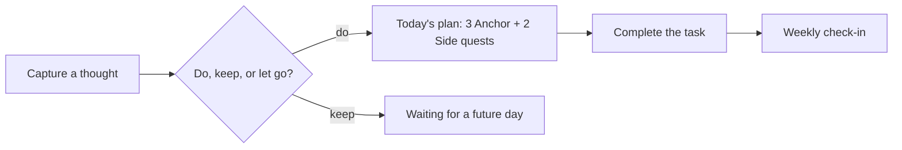

# Cove

An iPhone planner for adults with ADHD: capture a thought, pick what matters today, and finish it.

`Swift` `SwiftUI` `SwiftData` `XCTest`

## Overview

Most to-do apps make you organize before you can act. Cove keeps it small. You write down one thought, Cove suggests whether to **do**, **keep**, or **let go** of it, and actionable items go into a short daily plan: **three Anchor tasks and two Side quests**.

The current build is a four-week field study that tests one question: does this approach help people choose and finish what matters each week?

## Features

- **Text-first capture.** One thought at a time, with no forms or categories to fill in.
- **On-device suggestions.** Cove suggests *do / keep / let go* for each entry without any network call.
- **A small daily plan.** Three Anchor slots and two Side quest slots. Anything else waits for a future day.
- **Weekly check-ins.** One short, fixed-choice check-in per study week.
- **Private by design.** Everything stays on the device. There's no account, backend, analytics, or external AI. Participants can share a report with no personal content in it, or erase everything.

## How it works



Data is stored locally with SwiftData. The optional study report contains only a pseudonymous participant ID, event names, rough timings, and check-in answers. Captured text and task titles are never included, and nothing uploads automatically.

## Quick start

Requires a current version of Xcode.

1. Clone the repo: `git clone https://github.com/asquitt/cove.git`
2. Open `Cove/Cove.xcodeproj` in Xcode.
3. Select the **Cove** scheme and an iPhone simulator, then press Run.

## Running tests

Run the `CoveTests` and `CoveUITests` targets from Xcode (Product → Test). A static project check is also included:

```bash
scripts/verify-cohort-static.sh
```

## Project structure

```text
Cove/Cove/              app entry point and views
Cove/Cove/Cohort/       study models, domain logic, storage, and screens
Cove/CoveTests/         unit tests
Cove/CoveUITests/       UI tests
docs/                   study protocol, privacy, TestFlight, and evidence notes
```

Older exploratory code is still in the repo for reference but isn't part of the app build.

## Status

- **In user testing.** Cove is running as a small, ten-person study, not as a public App Store release.
- The study is set to continue only if at least 6 of 10 participants complete the full flow every week, at least 2 of 10 say they'd pay $4.99/month, and there are no privacy or data-loss incidents.
- TestFlight purchases are sandbox transactions, so the study measures willingness to pay, not revenue.

More detail: [study protocol](docs/COHORT_PROTOCOL.md) · [privacy](docs/PRIVACY.md) · [TestFlight release](docs/TESTFLIGHT_RELEASE.md)

## Author

Built by [Demario Asquitt](https://github.com/asquitt).
